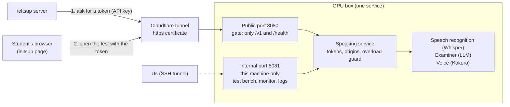
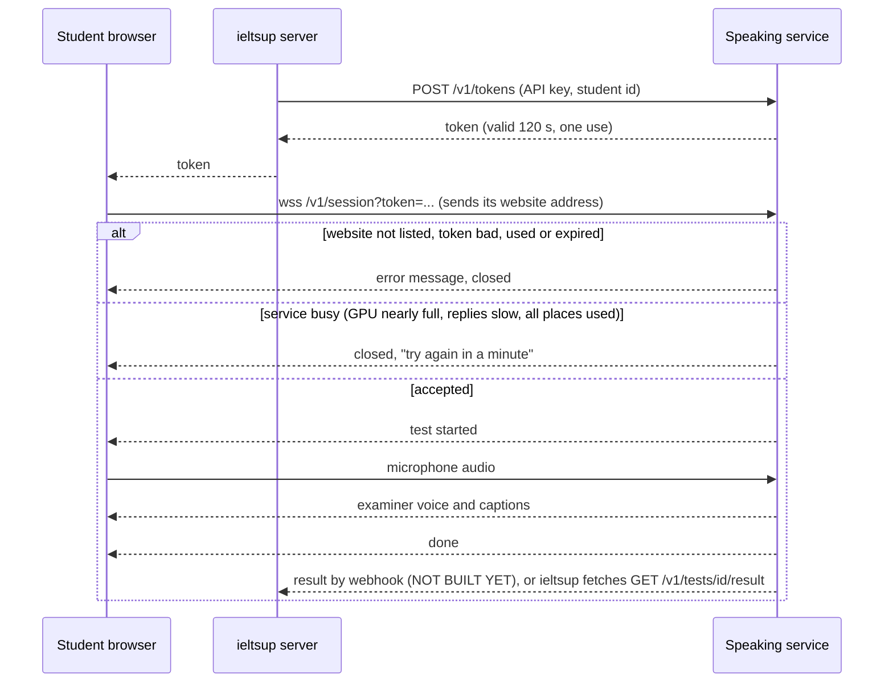
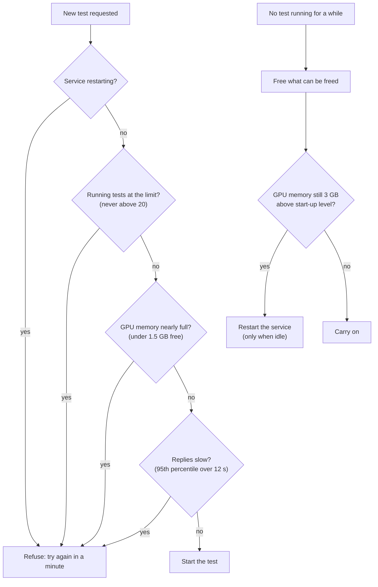

# Update, 2026-11-25

Where the IELTS speaking service stands at the end of today. Today was **Day 1 of the two-day plan to hand the service to ieltsup** (`docs/ROADMAP_2_DAYS.md`): make the service safe to put on the internet and usable directly from a student's browser.

## Summary for the manager

> **Status, 25 Nov.** The speaking service (voice recognition, examiner and voice in one service) works end to end on a GPU. Today we finished the security and access layer ieltsup needs: the browser connects directly with a short-lived token, only the allowed ieltsup websites can connect, the internal monitor and logs are no longer reachable from outside, and the service now refuses new students instead of going silent when the GPU is overloaded. All of it is tested and merged.
> **We are 1 day behind the plan** for adding it to the main website: the result-delivery (webhook) part, one-command packaging, the real-voice test and the first test from ieltsup's page are still to do, and we still need ieltsup's answers (site addresses, webhook details) and a domain for the public address.
> **GPU cost and concurrency:** the first measurements (one RTX 3090: about 9 tests comfortable, about 26 without errors, breaks at 29+) are real, but they used synthetic voices. One clean GPU session with real voices, after the staging address is up, will give the final cost and concurrency numbers.

## What was done today

| # | Step | Result | PR (personal repo) |
|---|---|---|---|
| 1 | Close open data routes | Run logs, transcripts and server logs now need the monitor key. The real service refuses to start without its keys. | PR #18 |
| 2 | Split public and internal ports | Public port 8080 serves only `/v1` and `/health`. The test bench, monitor and logs are on an internal port (8081, this machine only). | PR #19 |
| 3 | Signed browser tokens | ieltsup's server asks for a token per student; the browser connects with it. 120 seconds to start, one test per token, candidate identity inside the token. | PR #20 |
| 4 | Allowed websites | Only listed ieltsup sites can open a test from a browser. CORS only on `/health`. | PR #21 |
| 5 | Overload safety | New tests are refused (not silently dropped) when the GPU is nearly full or replies are slow; GPU memory that is not given back triggers a clean restart when idle. | PR #22 |
| 6 | Public address tooling | Tunnel script, an outside-in checker ieltsup can run, security headers, line-ending fix for the deploy scripts. | PR #23 |

Also: branches cleaned up after each merge; `main` is identical in the company repo and the personal repo (same files).

Tests: about 280 automated tests pass on the development PC. 6 failures and 10 errors remain there only because the voice library (`pipecat`) cannot be installed on this PC; they pass where it is installed. Server-side tests that need it were run with a stand-in (223 pass). **Nothing from today has been run on a GPU yet.**

## How it fits together

### The service as ieltsup sees it

### One student's test

### Overload protection (new tests only; running tests are never cut off)

## Plan status

```mermaid
flowchart LR
    subgraph D1["Day 1 (done today)"]
        a1["1 Close open routes"] --> a2["2 Public / internal split"] --> a3["3 Browser token"] --> a4["4 Allowed websites"] --> a5["5 Overload safety"] --> a6["6 Public address tooling"]
    end
    subgraph D2["Day 2 (not started: 1 day behind)"]
        b1["Webhook sender"] --> b2["One-command start"] --> b3["Retention and privacy"] --> b4["Real-voice GPU test"] --> b5["First test from ieltsup page"] --> b6["Integration guide"]
    end
    a6 --> b1
    style D1 fill:#e6f4ea,stroke:#2e7d32
    style D2 fill:#fff4e5,stroke:#ef6c00
```

## Why we are one day behind

- Day 1 took the full day: the six steps were built one at a time, each with its tests, merged and cleaned up before the next.
- The public address (step 6) is built and tested but **cannot go live** without a domain and a Cloudflare account, and ieltsup's site addresses. These were not available today.
- Day 2 has not started. The webhook design also depends on ieltsup's answers to our 16 questions, which are still pending.

## Still needed

| Need | From |
|---|---|
| A domain on Cloudflare and the hostname for staging (for example `speaking-staging.<domain>`), plus a Cloudflare account to create a tunnel | you or ieltsup |
| The exact website addresses of ieltsup's pages (production and staging); until they are set no browser can connect | ieltsup |
| Answers to the 16 questions (webhook address, signing, retries, rejoin, one test per booking, privacy, contact) | ieltsup |
| A decision on student voices on a rented GPU host (privacy) | you and ieltsup |
| GPU session budget (about $3-5 for the remaining work) and 2-3 non-native speakers for 30 minutes | you |

## Tomorrow (Day 2, in this order)

1. Webhook sender: signed, with retries, and `GET /v1/tests/{id}/result` as ieltsup's fallback.
2. One-command start of the whole service, with `ready` only when all three models answer.
3. Retention and privacy of recordings and transcripts.
4. Real-voice GPU test: repeat the capacity ramp, confirm the overload thresholds, set the final `MAX_SESSIONS`. This gives the clean **GPU cost and concurrency** numbers for the manager.
5. Staging run from an ieltsup page, then the integration guide.

## Where things are

- Public address steps and the outside check: `docs/DEPLOY_PUBLIC.md`, `python -m eval.check_public`.
- Contract for ieltsup (tokens, close codes, health, headers): `docs/API_CONTRACT_V1.md`.
- Progress log and decisions: `docs/PROGRESS.md`, `docs/DECISIONS.md`. Plan: `docs/ROADMAP_2_DAYS.md`. Yesterday: `docs/UPDATE_2026-11-24.md`, `docs/GPU_TEST_2026-11-24.md`.
